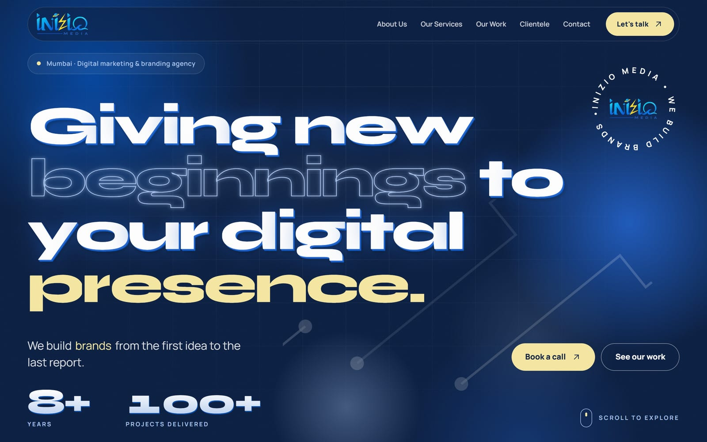
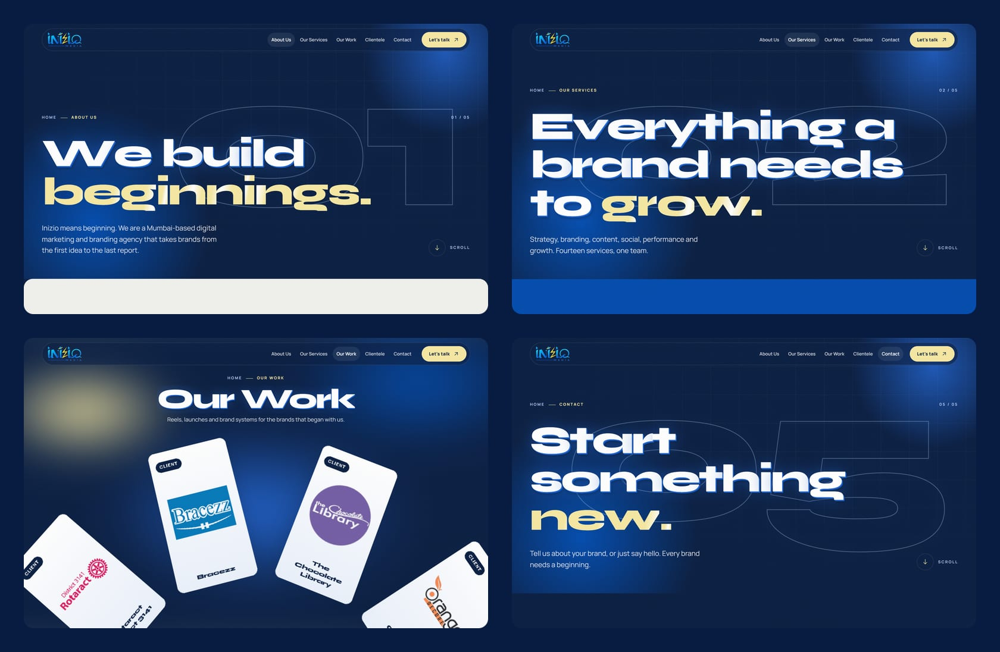
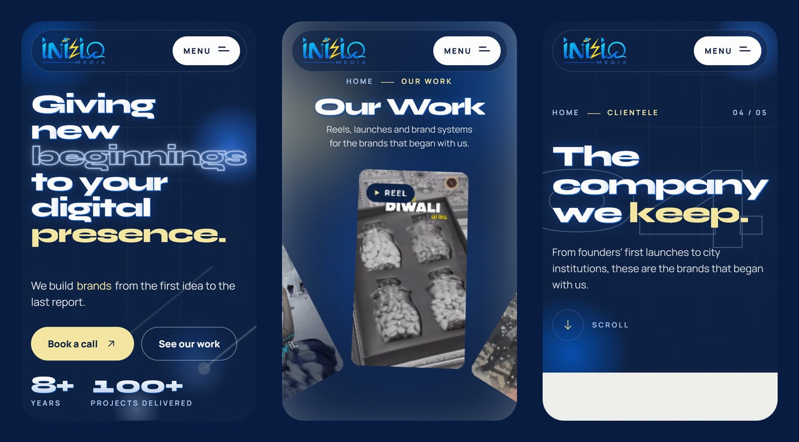
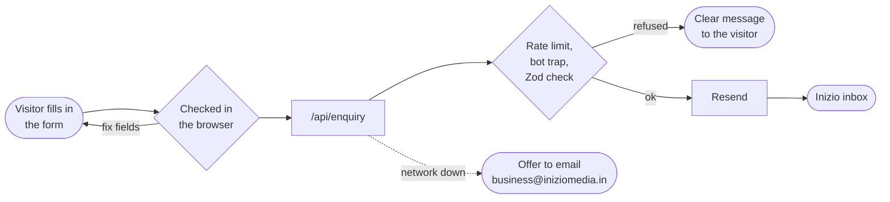

<div align="center">

<a href="https://www.iniziomedia.in">
  
</a>

### We build brands.

The website of **Inizio Media**, a digital marketing and branding agency in Mumbai.<br>
Strategy · Branding · Content · Social · Performance · Growth

<br>

[](https://www.iniziomedia.in)
[](https://www.instagram.com/iniziomedia_/)
[](https://www.linkedin.com/company/teaminiziomedia/)


<br>

<a href="https://www.iniziomedia.in">
  
</a>

</div>

<br>

## Contents

- [The site](#the-site)
- [What makes it feel alive](#what-makes-it-feel-alive)
- [Screens](#screens)
- [Built with](#built-with)
- [Run it locally](#run-it-locally)
- [Changing the content](#changing-the-content)
- [How an enquiry reaches the inbox](#how-an-enquiry-reaches-the-inbox)
- [Quality and security](#quality-and-security)
- [Deploying](#deploying)
- [Brand palette](#brand-palette)

<br>

## The site

Six pages. Each one has its own address, title and description, so every page can be found on Google.

| Page | Address | What is on it |
| :--- | :--- | :--- |
| **Home** | [`/`](https://www.iniziomedia.in) | The hero, results that count up, an index that leads to every page |
| **About Us** | [`/about`](https://www.iniziomedia.in/about) | Who Inizio is and how the team works |
| **Our Services** | [`/services`](https://www.iniziomedia.in/services) | 13 services, each in its own folder with a photo from the studio |
| **Our Work** | [`/work`](https://www.iniziomedia.in/work) | A spinning wheel of 8 client reels and a 51-image gallery |
| **Clientele** | [`/clientele`](https://www.iniziomedia.in/clientele) | A draggable, self-scrolling wall of 30+ client brands |
| **Contact** | [`/contact`](https://www.iniziomedia.in/contact) | The enquiry form, both phone lines, email and socials |

Old addresses from the previous WordPress site (`/about-us`, `/contact-us`, `/blog/...` and others) redirect permanently to the matching new page, so old Google results still land somewhere useful.

<br>

## What makes it feel alive

<table>
<tr>
<td width="50%" valign="top">

**🎬 Motion**
- A logo loader on navy when the site first opens
- A curtain transition between pages
- Smooth scrolling with Lenis
- Headlines that split and rise in, words that light up as you scroll
- Magnetic buttons, a custom cursor and a spotlight that follows the mouse
- Numbers that count up to the real figures

</td>
<td width="50%" valign="top">

**🧭 Built to be used**
- Fits every screen from a small phone to a wide desktop, with no sideways scrolling
- Everything works by keyboard, with a visible focus ring
- Respects "reduce motion": the animations step aside
- Still readable with JavaScript switched off
- Self-hosted fonts (Syne and Manrope), WebP images, short preview loops for the reels

</td>
</tr>
<tr>
<td width="50%" valign="top">

**🔎 Found on Google**
- A sitemap and robots file, generated for you
- Structured data telling Google the site name, logo, services, area and contacts
- Canonical addresses, Open Graph tags and `en-IN` language
- A favicon, app icons and a logo sized for search results

</td>
<td width="50%" valign="top">

**🛡️ Locked down**
- A strict Content Security Policy and security headers on every page
- The enquiry form checks every field on the server, limits each visitor to 5 messages per 10 minutes, and quietly drops bots
- Email keys stay on the server and never reach the browser
- 0 known vulnerabilities in production dependencies

</td>
</tr>
</table>

<br>

## Screens

<div align="center">
  
  <br><br>
  
</div>

<br>

## Built with

| | |
| :--- | :--- |
| **Framework** | [Next.js 16](https://nextjs.org) (App Router, Turbopack) and [React 19](https://react.dev) |
| **Language** | TypeScript, with strict type checking |
| **Styling** | CSS Modules plus design tokens compiled from [`design-system/tokens.json`](design-system/tokens.json) |
| **Animation** | [Motion](https://motion.dev) and [Lenis](https://lenis.darkroom.engineering) smooth scroll |
| **Validation** | [Zod](https://zod.dev) on the enquiry form, on both the browser and the server |
| **Email** | [Resend](https://resend.com), sending from `iniziomedia.in` |
| **Testing** | [Vitest](https://vitest.dev) and Testing Library for units, [Playwright](https://playwright.dev) end-to-end in Chrome |
| **Hosting** | [Vercel](https://vercel.com). Every push to `main` goes live |

<br>

## Run it locally

You need **Node.js 22.12 or newer**.

```bash
git clone https://github.com/Spider2011/Inizio-Media.git
cd Inizio-Media
npm ci
```

```bash
cp .env.example .env.local
```

```bash
npm run dev
```

Then open **http://localhost:3000**.

### Environment variables

All of them are optional when you work locally. Without an email key, the form offers to open the visitor's own email app instead.

| Variable | What it does |
| :--- | :--- |
| `RESEND_API_KEY` | The Resend key used to send enquiries. **Server only, never commit it.** |
| `ENQUIRY_TO` | The inbox that receives enquiries |
| `ENQUIRY_FROM` | The sender, on a domain verified in Resend, e.g. `Inizio Media <hello@iniziomedia.in>` |
| `NEXT_PUBLIC_SITE_URL` | The public address used for canonical links and the sitemap (Vercel fills this in on production) |

### Scripts

| Command | What it does |
| :--- | :--- |
| `npm run dev` | Start the development server with hot reload |
| `npm run build` | Make the production build |
| `npm start` | Serve the production build |
| `npm test` | Run the unit and component tests |
| `npm run coverage` | The tests, plus a coverage report |
| `npm run e2e` | End-to-end tests in a real Chrome |
| `npm run lint` | ESLint |
| `npm run typecheck` | TypeScript type check |
| `npm run tokens` | Rebuild `src/styles/tokens.css` from the design tokens |
| `npm run gallery` | Rebuild the Our Work gallery from photos in `/images` |
| `npm run reels` | Rebuild the reels from videos in `/REELS` (needs ffmpeg) |

<br>

## Changing the content

All the words, numbers and lists live in plain files under [`src/content`](src/content), away from the design code, so most changes take one edit.

| To change… | Edit |
| :--- | :--- |
| Phone numbers, email, socials, menu | [`src/content/site.ts`](src/content/site.ts) |
| Services and their photos | [`src/content/services.ts`](src/content/services.ts) |
| Client logos and links | [`src/content/clients.ts`](src/content/clients.ts) |
| The "8+ years / 100+ projects" figures | [`src/content/stats.ts`](src/content/stats.ts) |
| The four process steps | [`src/content/process.ts`](src/content/process.ts) |
| Page titles and descriptions | [`src/content/pages.ts`](src/content/pages.ts) |
| Testimonials (hidden until real quotes arrive) | [`src/content/testimonials.ts`](src/content/testimonials.ts) |
| Gallery photos | Put them in `/images`, then run `npm run gallery` |
| Reels | Put them in `/REELS`, update the picks, then run `npm run reels` |

<details>
<summary><b>Project structure</b></summary>

```text
├── design-system/tokens.json   Brand colours, type and spacing (the source of truth)
├── e2e/                        Playwright end-to-end tests
├── public/                     Images, reels, logo and the loader script
├── scripts/                    Gallery, reels and token builders
└── src/
    ├── app/                    Pages, the enquiry API, sitemap, robots, icons
    ├── components/
    │   ├── fx/                 Loader, cursor, smooth scroll, text and scroll effects
    │   ├── sections/           Hero, services, process, clients, contact form…
    │   ├── site/               Header, menu, footer, page shell
    │   └── work/               Reel wheel, player and gallery grid
    ├── content/                Everything the site says (edit here)
    ├── data/                   Generated gallery and reel lists
    ├── hooks/                  Small React hooks
    ├── lib/                    Validation, rate limit, email, SEO data, maths
    └── styles/                 Global CSS, tokens and fonts
```

</details>

<br>

## How an enquiry reaches the inbox



Email from `iniziomedia.in` is signed with SPF, DKIM and DMARC, so enquiries land in the inbox rather than spam.

<br>

## Quality and security

- **153 unit and component tests** across 25 files, plus end-to-end tests that load every page in Chrome and check for errors, sideways scrolling, animations that finish, the logo wall and the enquiry form.
- **Type-checked and linted** on every change.
- **Security headers:** `Content-Security-Policy`, `X-Frame-Options: DENY`, `X-Content-Type-Options`, `Referrer-Policy`, `Permissions-Policy` and `Cross-Origin-Opener-Policy`.
- **The enquiry API** only accepts JSON, caps the message size at 10 KB, rate-limits each visitor and never reveals why a bot was refused.
- **HTTPS everywhere.** The bare domain redirects to `www`.

<br>

## Deploying

The site is hosted on **Vercel** and builds itself:

1. Push to `main`.
2. Vercel builds the new version and puts it live at **[www.iniziomedia.in](https://www.iniziomedia.in)** in about a minute.
3. If anything goes wrong, any earlier version can be restored with one click under **Deployments** in Vercel.

The domain is registered at GoDaddy and points to Vercel. Business email (`business@iniziomedia.in`) is also hosted at GoDaddy.

<br>

## Brand palette

| | Name | Hex | Used for |
| :---: | :--- | :--- | :--- |
|  | Blue | `#004aad` | The brand colour: buttons, accents, numbers |
|  | Navy | `#071c40` | Dark sections and the footer |
|  | Butter | `#f6e7a1` | Highlights and calls to action on navy |
|  | Sky | `#a9c4ee` | Quiet text on navy |
|  | Paper | `#f0f0ec` | Light section backgrounds |
|  | Ink | `#141414` | Body text |

Type: **Syne** for headlines, **Manrope** for everything else.

<br>

---

<div align="center">

**Inizio Media** · Mumbai, India

[business@iniziomedia.in](mailto:business@iniziomedia.in) · [+91 90823 22109](tel:+919082322109) · [+91 84337 57541](tel:+918433757541)

<sub>© Inizio Media. All rights reserved. The code, brand, logos, photography and client work in this repository belong to Inizio Media and its clients, and may not be reused without permission.</sub>

</div>
